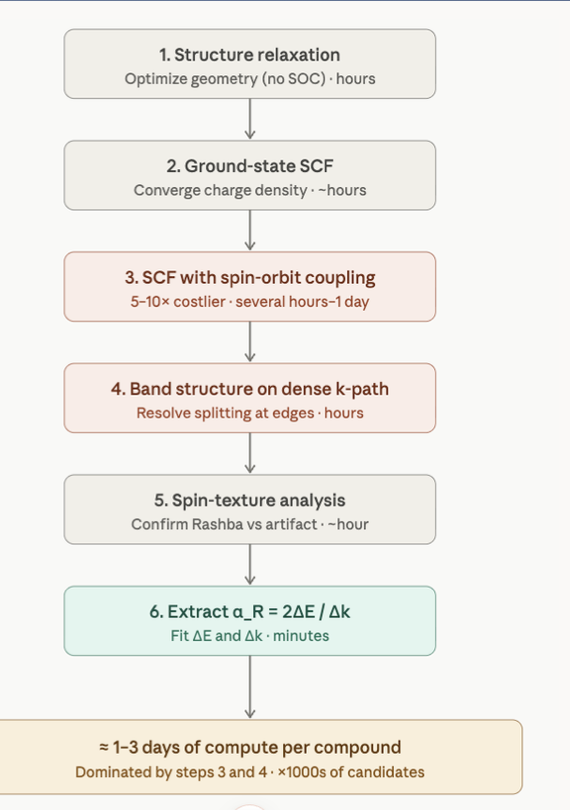
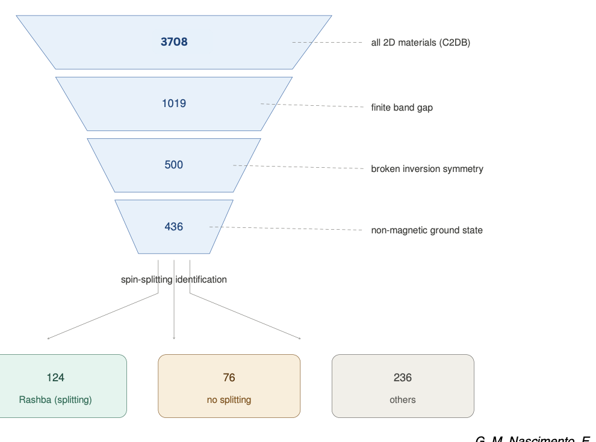
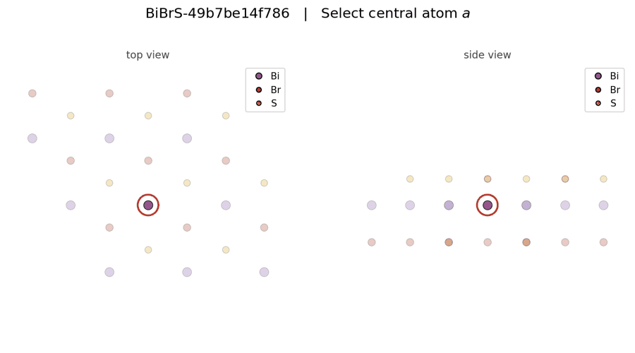
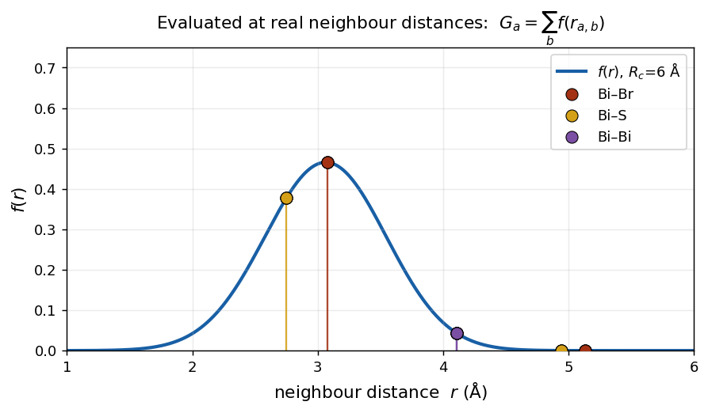
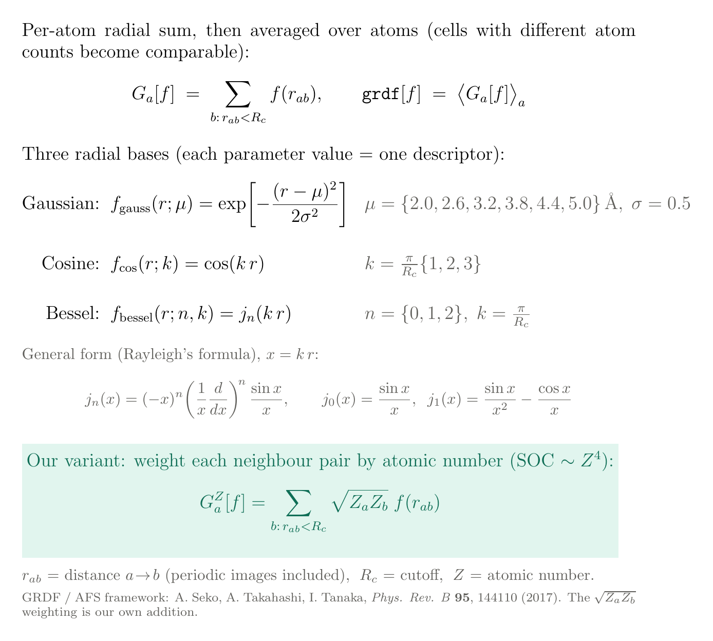
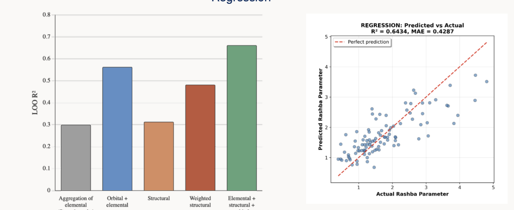
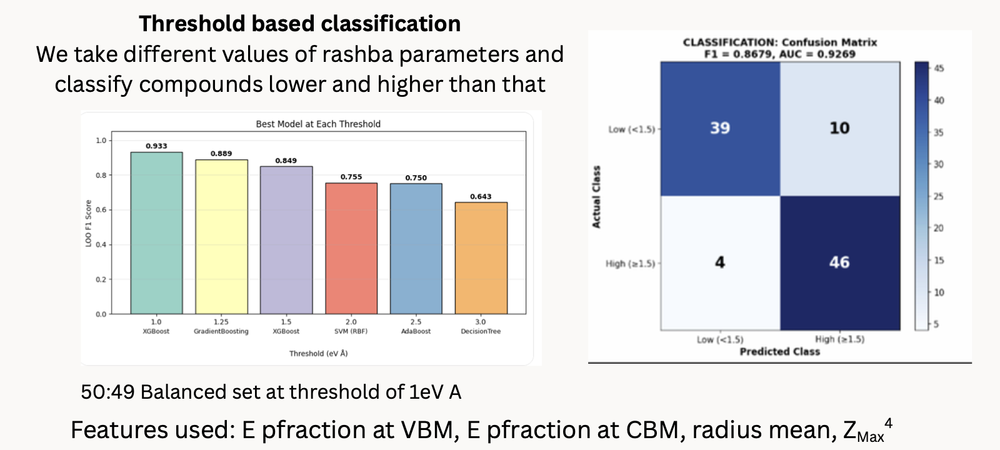
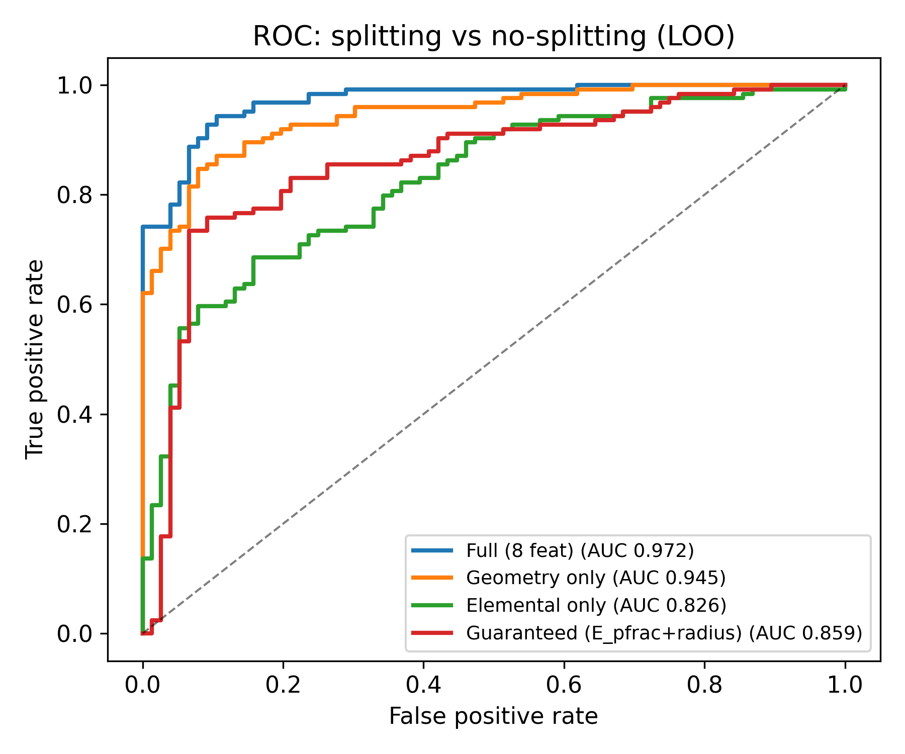
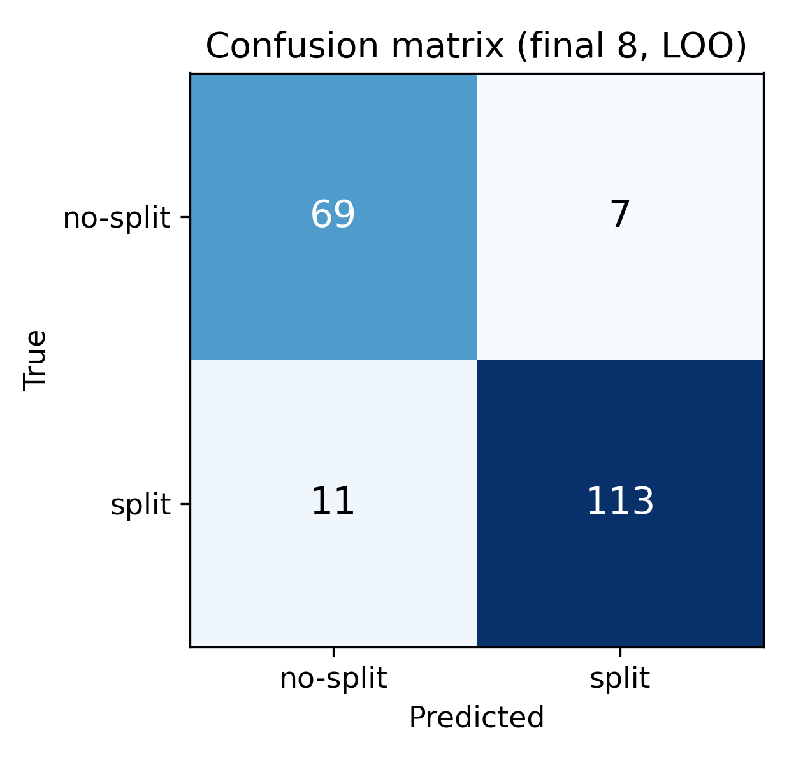
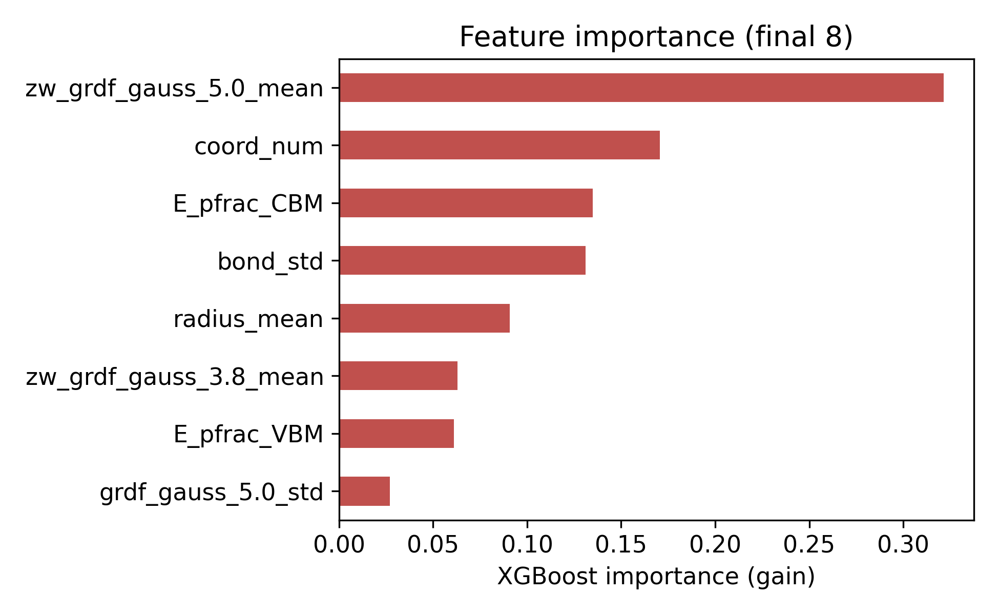

# Predicting Rashba splitting in 2D materials with ML

Dual Degree Project, IIT Bombay (2025–26)

Thesis: [`docs/DDP_thesis.pdf`](docs/DDP_thesis.pdf) · Slides: [`docs/DDP_stage2_slides.pdf`](docs/DDP_stage2_slides.pdf)

---

## The problem

The Rashba effect lets you control electron spin with an electric field, which makes it useful for spintronics. 2D materials are good hosts because the layer itself can break inversion symmetry.

Finding Rashba materials is expensive, though. Every candidate needs a full DFT calculation with spin-orbit coupling, which takes roughly 1–3 days of compute per compound.

<p align="center"></p>

The goal of this project is to predict Rashba behaviour from cheap compositional and structural features, so that DFT only has to run on the promising candidates.

## Data

All compounds come from one high-throughput study (Nascimento et al., *Scientific Data* 2022) built on C2DB, so every value was computed with the same DFT settings.

<p align="center"></p>

All 200 compounds used here (124 splitting, 76 non-splitting) are already non-magnetic, non-centrosymmetric and have a finite band gap. So the non-splitting set is a **matched negative class**: a classifier can't separate the two groups using magnetism, symmetry or metallicity, because those are the same on both sides.

## Descriptors

There are three families, from cheapest to most expensive:

| Family | What it captures | Examples |
|---|---|---|
| Elemental | composition only | `max_Z`, `max_Z4`, `radius_mean`, `n_elements` |
| Structural | local geometry around each atom | GRDF (Gaussian / cosine / Bessel), coordination number, bond-length spread |
| Orbital | band-edge character, needs a DOS | p-fraction at the VBM and CBM (`E_pfrac_VBM`, `E_pfrac_CBM`) |

The structural features use the GRDF / AFS framework (Seko et al., PRB 2017). For every atom, you sum a radial basis function over its neighbours, then average over all atoms. The animation steps through this for BiBrS:

<p align="center"></p>

<p align="center"></p>

The main addition in this project is a **Z-weighted GRDF**. Each neighbour pair is weighted by √(Z_a·Z_b), because spin-orbit coupling scales roughly as Z⁴. This turned out to be the single most useful feature.

<details>
<summary>Full GRDF definition</summary>
<p align="center"></p>
</details>

## Results

All scores are leave-one-out cross-validated unless stated otherwise. With 100–200 compounds, LOO uses almost all of the data for training at every step.

### 1. Regression of α_R: hits a ceiling

<p align="center"></p>

- **Best result:** combining elemental, structural and orbital features gives **R² ≈ 0.66**.
- **Other models:** ten different models (linear through XGBoost and TabNet) do no better.
- **More data:** an external dataset about 30× larger also stops at roughly 0.61.

So the limit seems to be the target itself, not the amount of data. That's why the next step treats this as a screening problem instead.

### 2. Strong vs weak Rashba (threshold classification)

This asks whether α_R is above a cut-off. At **1.0 eV·Å** the set is close to balanced (50:49) and XGBoost reaches **F1 0.93**, using only 4 features.

<p align="center"></p>

### 3. Splitting vs no splitting (main result)

The model is XGBoost with class weights. Features were added greedily with forward selection, one at a time, keeping each only if the cross-validated score improved. The final model has 8 features.

| | LOO AUC | 5-fold AUC (5 seeds) |
|---|---|---|
| Full model (8 features) | **0.972** | 0.967 ± 0.006 |
| Z-weighted structural only | 0.889 | 0.878 ± 0.004 |
| Orbital + radius | 0.859 | 0.850 ± 0.006 |
| Elemental only | 0.790 | 0.804 ± 0.019 |

<p align="center">
  
  
</p>

<p align="center"></p>

Takeaways:
- **Most of the signal is structural.** Z-weighted structural features alone reach 0.889, well above the composition-only baseline of 0.790.
- **The expensive orbital features add only a little.** A screen built without any band-structure calculation recovers most of the performance.
- **The result isn't leakage:**
  - Shuffling the labels drops the AUC to about 0.53.
  - No single feature goes above 0.73 on its own.
  - The two classes have no missing values, so missingness can't separate them.
- **The errors:** 18 of the 200 compounds are misclassified. They're listed in [`misclassified.csv`](environment/expand-results/misclassified.csv), with a browsable version in [`rashba_classifier_error_analysis.html`](environment/expand-results/rashba_classifier_error_analysis.html).

## Repository layout

```
Data/                     source CSVs (Rashba, Dresselhaus, Zeeman, higher-order)
Inverse-design/           scripts to download and organise structures (structures themselves not tracked)
K-path/                   per-k-path descriptors (nb5), feature selection (nb6)
  old+new_nb6/            merged dataset, regression + threshold classification (nb7), outliers (nb8)
Weight-contribution/      orbital p-fraction descriptors from the projected DOS
environment/              GRDF / AFS structural descriptors (nb0)
  nb_expand_dataset.ipynb   200-compound presence classifier (main result)
  expand-results/           figures, metrics, per-compound predictions
new-descriptors/          extra descriptor families tried (nb9–nb14); none beat the curated set
inversion-symmetry/       next-step notebooks for broken-inversion analysis (not run yet)
docs/                     thesis, slides, README figures
```

The `nb*` numbers follow the order the work was done in, not importance. If you only want the final pipeline, start with `environment/nb0_environment_descriptors-v2.ipynb`, then `environment/nb_expand_dataset.ipynb`.

## What's next

- Look at the 18 misclassified compounds in more detail.
- Move to broken-inversion-symmetry descriptors (`inversion-symmetry/`).
- Plug the classifier into a high-throughput screen of candidate 2D materials.

## References

- G. M. Nascimento, E. Ogoshi, A. Fazzio et al., *Scientific Data* 9, 195 (2022): source dataset.
- A. Seko, A. Takahashi, I. Tanaka, *Phys. Rev. B* 95, 144110 (2017): GRDF / AFS descriptors.
